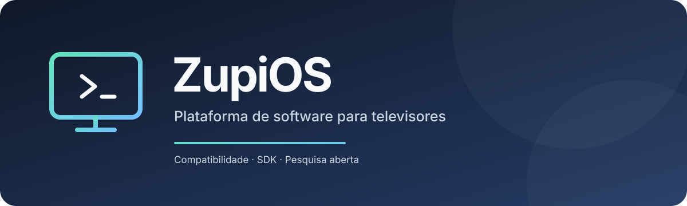

**Uma plataforma de software para televisores, com SDK próprio e foco em compatibilidade entre dispositivos.**

[Documentação](docs/Home.md) · [Roadmap](planning/Roadmap.md) · [Como contribuir](CONTRIBUTING.md) · [Segurança](SECURITY.md)

## Sobre o projeto

O ZupiOS é um projeto em estágio inicial para investigar e desenvolver uma plataforma de software para televisores. O objetivo é oferecer uma experiência consistente entre dispositivos compatíveis e, futuramente, um SDK para aplicações.

O projeto ainda está na fase de definição, pesquisa de hardware e decisões arquiteturais. **Ainda não há uma versão funcional publicada nem uma lista de dispositivos homologados.** A organização do repositório representa a estrutura planejada, não funcionalidades já implementadas.

## Estado atual

- **Fase:** descoberta técnica, documentação e planejamento.
- **Prova experimental:** existe uma prova de boot BIOS legado em QEMU que carrega e executa um segundo setor. Isso não é um kernel nem um sistema operacional funcional; veja [procedimento e limites](tests/boot-poc/README.md).
- **Dispositivo de referência em investigação:** Samsung UN40J6400AGXZD. A viabilidade de execução nativa ainda não foi confirmada.
- **Arquitetura:** sistema-base, runtime, linguagem, SDK e método de inicialização para o produto ainda não foram definidos.
- **Compatibilidade:** nenhum dispositivo deve ser considerado suportado sem evidências e testes documentados.
- **Licença:** ZupiOS Source-Available License (ZSL) 0.1, provisória e ainda não revisada juridicamente. Leia [LICENSE](LICENSE) antes de reutilizar o conteúdo.

## Estrutura do repositório

| Caminho | Conteúdo |
| --- | --- |
| [docs/](docs/Home.md) | Documentação de referência em Markdown, compatível com Obsidian |
| [planning/](planning/README.md) | Decisões, roadmap, backlog e próximos passos |
| [src/](src/README.md) | Estrutura reservada ao código da plataforma |
| [sdk/](sdk/README.md) | Estrutura reservada ao SDK |
| [tests/](tests/README.md) | Provas experimentais e testes automatizados |
| [device-profiles/](device-profiles/README.md) | Perfis de dispositivos e capacidades verificadas |

A organização atual não determina linguagem, sistema-base, runtime, bootloader ou arquitetura interna.

## Começar

1. Leia a [página inicial da documentação](docs/Home.md).
2. Consulte o [roadmap](planning/Roadmap.md), o [backlog](planning/Backlog.md) e os [registros de decisão](planning/decisions/).
3. Antes de propor uma mudança significativa, abra uma issue para discutir escopo e abordagem.
4. Leia as [diretrizes de contribuição](CONTRIBUTING.md) e a [política de segurança](SECURITY.md).

Para navegar com links internos `[[Nome da nota]]`, abra a raiz do repositório como vault no Obsidian.

## Contribuições

Relatos reproduzíveis, documentação, pesquisa técnica e resultados de testes são úteis nesta fase. Consulte [CONTRIBUTING.md](CONTRIBUTING.md). Toda contribuição está sujeita à revisão e aprovação do mantenedor.

## Segurança

Não publique vulnerabilidades exploráveis, credenciais, tokens ou dados pessoais em issues públicas. Siga o procedimento descrito em [SECURITY.md](SECURITY.md).

## Licença e marca

O repositório inclui uma minuta provisória, [ZupiOS Source-Available License (ZSL) 0.1](LICENSE), que busca refletir os objetivos registrados no ADR 0002. Ela ainda não foi revisada juridicamente e poderá ser alterada antes de uma versão estável. Não a trate como licença open source convencional. Consulte também [Estado da licença](docs/licensing/Estado-da-licenca.md).

O nome e a identidade visual ZupiOS também não implicam autorização para sugerir endosso oficial. A política de marca ainda será definida.
